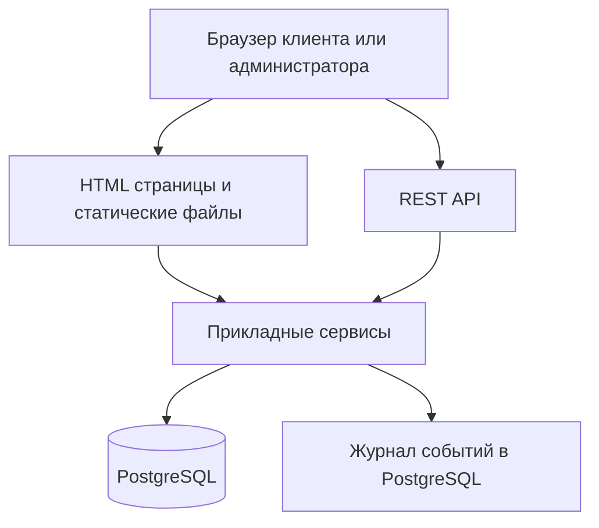
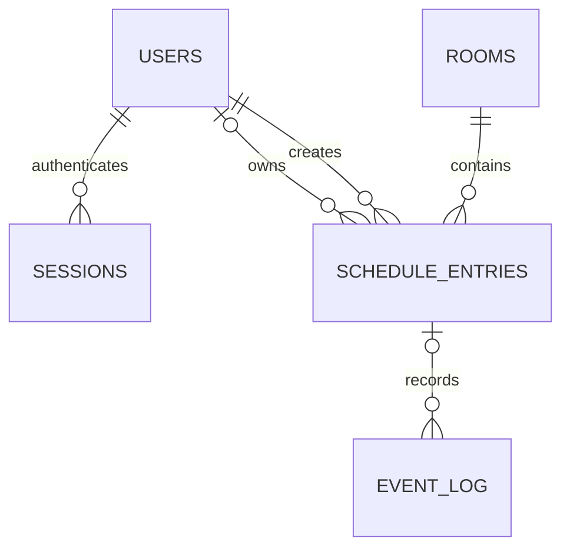

# Архитектура LumenBook

LumenBook — веб-сервис бронирования четырёх залов фотостудии на FastAPI и PostgreSQL. Интерфейс — HTML-шаблоны Jinja2, CSS и JavaScript. База данных запрещает пересечения броней и технических блокировок одного зала.

## Границы системы

В состав входят регистрация и вход, каталог залов, выбор времени, бронирование, имитация оплаты, личный кабинет, расписание администратора, ручной ввод, перенос и отмена, изменение цен и часов работы, блокировка под уборку или ремонт, журнал событий и демонстрационные данные.

Оплата выполняется кнопкой без банковских операций. Уведомление — сообщение на экране и запись в журнале. Заявки из мессенджеров и звонков вносит администратор. Публичный хостинг и внешние интеграции в MVP не входят.

Маршруты и форматы запросов: [REST API](REST_API.md).

## Компоненты приложения

Модульный монолит: одно приложение и одна база данных. HTML и JSON обслуживаются с одного origin. JavaScript запрашивает доступность и отправляет операции бронирования через REST API.

| Компонент | Ответственность |
| --- | --- |
| HTML-маршруты и шаблоны | Подготовка страниц, вывод данных, формы и навигация |
| REST-маршруты | Проверка формата запросов, аутентификация, HTTP-ответы |
| Сервис авторизации | Учётные записи, проверка пароля, сессии и роли |
| Сервис залов | Каталог, цены, часы работы и расчёт доступности |
| Сервис бронирования | Создание, оплата-заглушка, подтверждение, отмена, перенос и технические блокировки |
| SQLAlchemy | Модели, запросы и управление транзакциями |
| Alembic | Версионирование схемы, расширение и ограничения PostgreSQL |
| Скрипт демо-данных | Четыре зала, администратор, клиенты и расписание на ближайшую неделю |

HTML-маршруты и API вызывают общие сервисы. Бизнес-правила и запросы к БД выполняются на сервере, вне шаблонов.

Сессии SQLAlchemy и обработчики FastAPI синхронные. Одна сессия принадлежит одному запросу; успешная изменяющая операция завершается одной транзакцией, ошибка вызывает откат.

## Организация репозитория

| Каталог или файл | Назначение |
| --- | --- |
| `backend/app/main.py` | Создание FastAPI и подключение маршрутов |
| `backend/app/config.py` | Настройки из окружения |
| `backend/app/database.py` | Подключение и сессии БД |
| `backend/app/auth/` | Маршруты, схемы, модели и сервис авторизации |
| `backend/app/rooms/` | Каталог и настройки залов |
| `backend/app/bookings/` | Бронирование и общий календарь занятости |
| `backend/app/web/` | Маршруты HTML-страниц |
| `backend/app/events/` | Запись событий |
| `frontend/templates/` | HTML-шаблоны Jinja2 |
| `frontend/static/` | CSS, JavaScript и изображения |
| `backend/migrations/` | Миграции Alembic |
| `backend/tests/` | Проверки правил и API |
| `backend/scripts/` | Наполнение демо-данными |
| `compose.yaml`, `.env.example` | Локальный запуск и пример настроек |

В Docker шаблоны и статика включаются в образ приложения. Отдельный сервер frontend не нужен.

## Модель данных

### Пользователи и сессии

`users`: `id` UUID, `name`, `email` nullable, `phone` nullable, `password_hash`, `role` (`client` или `admin`), `consent_at` nullable, `created_at`. Нужен хотя бы один идентификатор входа: email или телефон. Нормализованные непустые email и телефоны уникальны каждый в своей колонке. Имя обязательно; телефон обязателен при создании брони.

Регистрация создаёт только клиента и сразу выполняет вход с заменой анонимной сессии. Обязательное согласие сохраняется в `consent_at`. Администратор создаётся командой `python -m scripts.create_admin` с интерактивным вводом пароля. Повторный запуск сохраняет пароль; контакт клиента нельзя использовать для повышения его роли. Автоматическое связывание ручной брони с аккаунтом по совпадению телефона не выполняется: в MVP нет подтверждения владения телефоном.

`sessions`: `id` UUID, `token_hash`, `user_id` nullable, `csrf_token`, `expires_at`, `created_at`. Анонимная сессия позволяет защитить формы регистрации и входа от CSRF. После успешного входа идентификатор сессии и CSRF-токен заменяются.

### Залы

`rooms`: `id` UUID, `name`, `description`, `image_url`, `hourly_price_minor`, `opens_at`, `closes_at`, `version`, `updated_at`.

В MVP четыре зала, добавление и удаление залов через API не предусмотрены. Цены задаются в копейках целым числом. Исходные ставки: Циклорама — 2000 ₽, Лофт — 2500 ₽, Неон — 1800 ₽, Сканди — 2200 ₽. Часы работы одинаковы для всех дней недели и первоначально равны 09:00–23:00.

### Общий календарь

`schedule_entries` хранит и брони, и технические блокировки. Такое объединение нужно для единого ограничения пересечений в БД. API предоставляет их как разные ресурсы: `bookings` и `blocks`.

| Поля | Назначение |
| --- | --- |
| `id`, `room_id`, `starts_at`, `ends_at` | Зал и интервал занятости |
| `kind` | `booking` или `maintenance` |
| `status` | Для брони: `pending_payment`, `paid`, `confirmed`, `cancelled`; для блокировки: `confirmed`, `cancelled` |
| `user_id` nullable | Владелец клиентской брони; ручная запись может быть без аккаунта |
| `created_by` | Пользователь, создавший запись |
| `source` | `website`, `phone`, `telegram`, `vk`, `maintenance` |
| `contact_name`, `contact_phone`, `comment` | Снимок контактов и пожеланий для брони |
| `hourly_price_minor`, `total_price_minor` | Снимок ставки и итоговой суммы для брони |
| `paid_at` nullable | Факт имитации оплаты; сохраняется при подтверждении и отмене |
| `block_reason` nullable | `cleaning` или `repair` для технической блокировки |
| `version`, `created_at`, `updated_at` | Защита от устаревших изменений и время записи |

Для брони контакты и стоимость обязательны. Для технической блокировки обязательна причина, а владелец, контакты, стоимость и `paid_at` отсутствуют. Проверки типов записей закрепляются CHECK-ограничениями. Внешние ключи запрещают удаление используемых залов и пользователей.

### Журнал событий

`event_log`: `id`, `entry_id` nullable, `actor_id` nullable, `event_type`, `created_at`, `payload` JSONB. Записываются создание, оплата, подтверждение, перенос, отмена, блокировка, изменение настроек зала и `notification_simulated`.

Событие и изменение данных сохраняются в одной транзакции. В журнал не попадают пароли, токены, полные телефоны и email. Ошибки приложения записываются в стандартный вывод контейнера без чувствительных данных.

`notification_simulated` записывается после создания, оплаты, подтверждения, отмены и переноса брони, включая ручные записи. Текст результата возвращается в ответе операции и отображается интерфейсом.

## Правила времени и стоимости

Часовой пояс студии — `Europe/Moscow`. БД хранит моменты времени в `timestamptz`, API принимает ISO 8601 с явным смещением. Проверки календарной даты, часов работы и правила 24 часов выполняются в часовом поясе студии по серверному времени.

- Интервал полуоткрытый: `[начало, конец)`. Брони 12:00–13:00 и 13:00–14:00 совместимы.
- Начало и конец приходятся на целые часы, длительность — не меньше часа.
- Бронь находится в пределах одного местного календарного дня и часов работы зала. Окончание ровно в 23:00 разрешено при закрытии в 23:00.
- Нельзя создавать запись на уже начавшийся час. Горизонт бронирования: от сегодняшней даты до даты через 30 дней включительно.
- Одна бронь занимает один непрерывный интервал одного зала. Для раздельных интервалов создаются отдельные брони.
- Пять минут на выход и осмотр входят в забронированный час; дополнительный разрыв в сетке не создаётся.
- Сумму рассчитывает сервер: сохранённая ставка × целое число часов. Клиент не передаёт итоговую цену.
- Изменение цены зала влияет только на новые брони. Ставка и сумма существующей брони сохраняются.

При создании брони передаётся `room_version` из каталога или доступности. Если настройки зала изменились, сервер возвращает `409 ROOM_SETTINGS_CHANGED` до создания записи. Интерфейс обновляет цену и часы работы и предлагает подтвердить выбор заново.

## Статусы и операции

| Операция | Допустимое состояние | Результат |
| --- | --- | --- |
| Создание клиентом | Свободный интервал | `pending_payment`, время сразу занято |
| Оплата-заглушка владельцем | `pending_payment` | `paid`, заполнен `paid_at` |
| Подтверждение администратором | `paid` | `confirmed`, `paid_at` сохранён |
| Ручное создание администратором | Свободный интервал | `confirmed`, `paid_at = null` |
| Отмена | Любая неотменённая бронь | `cancelled`, время освобождено |
| Перенос | Любая неотменённая бронь | Меняется интервал, статус сохраняется |

`confirmed` означает подтверждённое время, а не факт оплаты: для ручной записи оплата не предполагается автоматически. Восстановление отменённой записи не предусмотрено — создаётся новая бронь.

Владелец может отменять и переносить свою бронь при `starts_at - server_now >= 24 часа`. Администратор не ограничен правилом 24 часов; новый интервал при переносе всё равно должен быть в будущем и проходить остальные проверки.

Перенос меняет только дату и время, сохраняя зал, длительность и стоимость. Для смены зала или длительности создаётся новая бронь; старая отменяется по общим правилам.

Неоплаченная бронь удерживает время до отмены владельцем по правилу 24 часов либо администратором. Автоистечения нет. Возврат денег при отмене не имитируется; факт оплаты остаётся в `paid_at`.

## Защита от пересечений и гонок

Для активных записей `schedule_entries` используется exclusion constraint по равенству `room_id` и пересечению временного диапазона `tstzrange(starts_at, ends_at, '[)')`. В ограничение входят все записи со статусом, отличным от `cancelled`, независимо от `kind`. Для UUID и GiST подключается `btree_gist`.

Ограничение запрещает пересечение брони с бронью, брони с уборкой и двух технических блокировок. [Документация PostgreSQL](https://www.postgresql.org/docs/15/rangetypes.html#RANGETYPES-CONSTRAINT).

Изменяющие расписание операции сначала блокируют строку зала, затем существующую запись календаря, если она есть. В одном порядке блокировок работают создание, перенос, отмена, оплата, подтверждение, блокировки и настройка зала. Это позволяет согласованно проверять текущие часы работы, цену и статус. Ожидание блокировки ограничивается таймаутом.

Предварительная проверка доступности не заменяет ограничение БД. При его нарушении транзакция откатывается, API возвращает `409 SLOT_UNAVAILABLE`. Остальные ошибки БД не маскируются под занятый слот.

При переносе обновляется существующая запись в одной транзакции. Если новый интервал занят, старый сохраняется после отката. Изменение и событие журнала фиксируются вместе.

Клиент передаёт известную `version` при изменении существующей записи. После блокировки сервер сравнивает версию; несовпадение даёт `409 VERSION_CONFLICT`. При успешном изменении версия увеличивается. Это защищает от действий из устаревшей вкладки.

При изменении часов работы сервер проверяет действующие и будущие активные записи. Если новое расписание исключает хотя бы одну из них, изменение отклоняется. Администратор сначала разрешает конфликты, затем повторяет изменение настроек.

## Авторизация и безопасность

Серверная сессия хранится в PostgreSQL, случайный токен — в cookie `lumenbook_session`. В БД хранится хеш токена; cookie имеет `HttpOnly`, `SameSite=Lax`, `Path=/` и `Secure` при HTTPS. Для локального HTTP допускается отключение `Secure`. Срок сессии — 12 часов без продления; выход удаляет сессию и cookie.

Изменяющие запросы требуют CSRF-токен, связанный с сессией, включая регистрацию, вход и выход. JavaScript форм отправляет JSON через REST API с заголовком `X-CSRF-Token`. Проверяется origin запроса. `SameSite` дополняет проверку токена. Основание: [рекомендации OWASP по CSRF](https://cheatsheetseries.owasp.org/cheatsheets/Cross-Site_Request_Forgery_Prevention_Cheat_Sheet.html).

Пароли — 8–128 символов без усечения, хеширование — Argon2id по [рекомендациям OWASP](https://cheatsheetseries.owasp.org/cheatsheets/Password_Storage_Cheat_Sheet.html). Ошибка входа не различает отсутствующего пользователя и неверный пароль.

Права проверяются сервером для каждой операции. Клиент получает только собственные брони; чужой идентификатор возвращает `404`. Публичная доступность не раскрывает контакты, владельцев и причины технических работ. Административные маршруты требуют роль `admin`. Пользовательский текст экранируется в шаблонах и не вставляется через небезопасный HTML.

## Развёртывание и проверка

Docker Compose запускает `app` и `db`. Данные PostgreSQL сохраняются в volume; порт БД по умолчанию не публикуется. Миграции выполняются перед запуском приложения. Демо-скрипт запускается явно, повторный запуск не создаёт дубликаты и не удаляет пользовательские записи. Полное демо-расписание формируется относительно даты запуска.

Для проверки антиовербукинга используется PostgreSQL той же основной версии, что в приложении. SQLite не воспроизводит необходимое ограничение диапазонов.

Обязательные проверки: два одновременных создания на один интервал; бронь против уборки; соседние интервалы; откат переноса; повторное бронирование после отмены; граница ровно 24 часа; сохранение цены после смены тарифа; права владельца и администратора; CSRF; устаревшая версия; конфликт смены часов работы; запуск на чистой БД.
